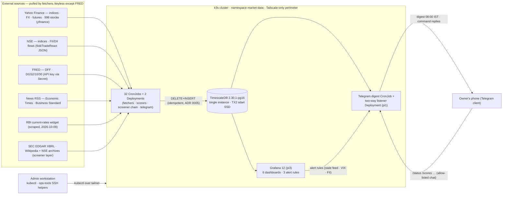
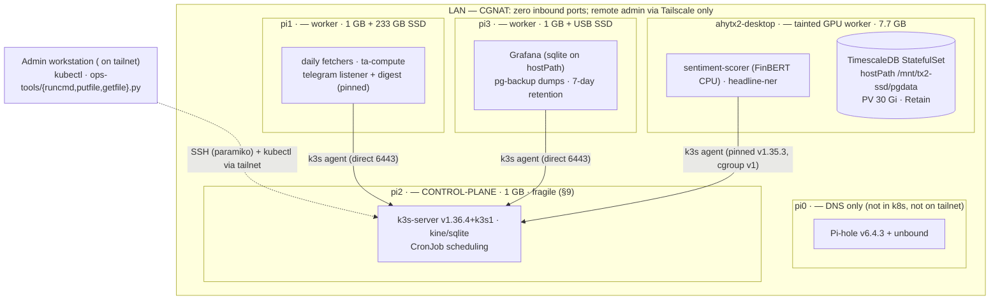
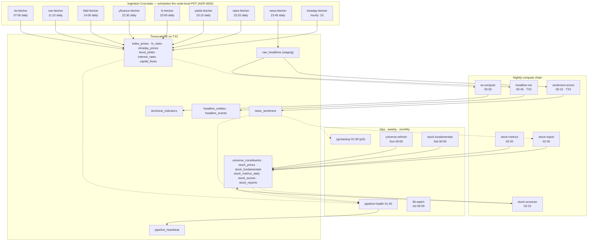
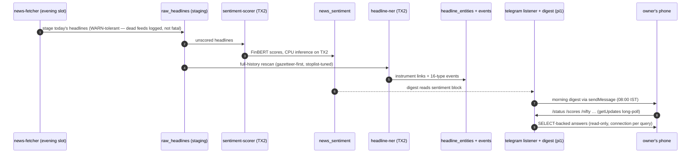
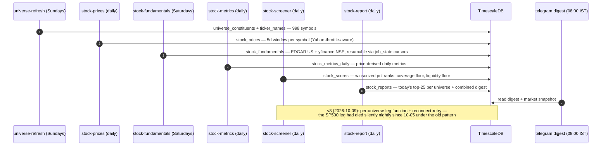

# Market Data Pipeline — System Architecture

> **Status:** live in production on the home k3s cluster. Updated 2026-10-18 (screener v12, health v5, roles,
> chunk merge, data foundations — plan: `engineering-plan-2026-10-18.md`). Reconciled with `manifests/` 2026-10-10
> (32 CronJobs since 2026-10-26; `ops-tools/workloads.py --check` keeps the tables honest). **Live state re-verified
> 2026-10-17: all 4 k8s nodes Ready (pi2 control-plane cordoned), every CronJob then deployed (23) active, TimescaleDB,
> Grafana, and Telegram bot all Running.** (see ops manual §8 and pending-tasks for known gaps).
> Doc map: this file = **architecture** (what the system is);
> `market-data-pipeline-plan.md` = design history + build log;
> `market-data-pipeline-operations-manual.md` = runbooks + copy-paste commands;
> `piCluster/homelab setup/SETUP.md` = Pi runbook; `homelab setup/TX2_AI_Edge_Lab_Setup_and_Test_Plan.md` = TX2 gotchas.
> Repo root for all `manifests/` + `ops-tools/` paths: `projects/marketdata/`.
> Proposed next build: `stock-screener-implementation-plan.md` (v1 build order —
> Nifty 500 + S&P 500 daily screening, maximum-history backfill, EDGAR fundamentals,
> not yet started) with `nifty500_sp500_fundamental_analysis_implementation_plan.md`
> as the target architecture (security master, sector-relative scoring, style lenses,
> market-regime layer).

A daily market-data platform for Indian + global markets: batch ingestion from public
feeds → TimescaleDB on the Jetson TX2 → CPU sentiment scoring → technical indicators →
Grafana dashboards, all orchestrated as k3s CronJobs and reachable only over Tailscale.

---

## 1. System overview

```
SOURCES (internet)
Yahoo Finance · NSE API · FRED · RSS feeds · NSE FII/DII · RBI rates widget ·
SEC EDGAR + Wikipedia/NSE archives (screener layer)
│ daily pulls from Pi workers (keyless except FRED); hourly fast-movers
▼
k3s CronJobs, namespace market-data — schedules fire NODE-LOCAL PDT (ADR 0002)
RBI 07:00 → NSE 11:15 → FII/DII 14:00 → yfinance 22:30 → fx 23:00 →
yields 23:15 → rates 23:20 → news 23:45 (stage) → sentiment 00:15 (TX2) →
TA 00:30 → headline-ner 00:45 (TX2) → backup 01:30 → health 01:45 →
metrics 02:00 → screener 02:15 → report 02:30 → digest 08:00 IST (pi1) ·
intraday hourly :10 (FX + gold/silver/oil/DXY) · universe Sun 09:00 ·
fundamentals Sat 06:00 · FDI watch monthly (1st, 09:00)
▼
TimescaleDB 2.30.1-pg16 (StatefulSet ×1 on TX2, sda4 SSD)
index_prices · fx_rates · commodity_prices · bond_yields · interest_rates
capital_flows · news_sentiment · technical_indicators · raw_headlines (staging)
headline_entities · headline_events · screener layer (§5.7)
├──▶ Grafana v12 (Deployment ×1 on pi3, tailnet-only, 6 provisioned dashboards
│     + 3 alert rules → Telegram, ADR 0009)
├──▶ pg-backup (daily pg_dump to pi3 SSD — second copy, independent hardware)
└──▶ Telegram bot (pi1): morning digest + two-way commands (ADR 0009)
```

**Design rules that hold the system together:**

1. Fetchers are logically idempotent through row-level `DELETE + INSERT` of their own
   `(key, ts)` rows — re-runs and late corrections overwrite cleanly, never duplicate.
   As of 2026-10-03 this is also **enforced at the DB level**: unique indexes on every
   natural key (see §4.2) guarantee no concurrent double-write can persist a duplicate.
2. No container registry (CGNAT homelab): images are built natively on the TX2,
   distributed as tarballs, pulled with `imagePullPolicy: Never`.
3. CronJob history limits kept tiny (`successfulJobsHistoryLimit: 3`,
   `failedJobsHistoryLimit: 1`) to spare pi2's etcd.
4. Nothing memory-heavy on pi2 (1 GB control-plane); the TX2 (7.7 GB) hosts the DB.

### 1.1 System context (Mermaid)

> Diagram convention used throughout this file: **solid arrows** = data writes or
> pulls, **dashed arrows** = reads or control-plane relationships. All diagrams are
> Mermaid fenced blocks (GitHub renders them natively).



### 1.2 Deployment view (Mermaid)



### 1.3 Data pipeline topology (Mermaid)



*Solid = writes, dashed = reads. The heartbeat job reads every feed table's
`max(ts)` and upserts one freshness row per feed (§5.5); the backup job reads the
whole DB via `pg_dump`.*

---

## 2. Infrastructure

### 2.1 Nodes (all k3s Ready, verified 2026-10-03)

| Node | Hardware | LAN IP | Tailscale IP | k3s | Role |
|---|---|---|---|---|---|
| pi0 | Pi 1 B+, 512 MB | <pi0-ip> | — (not on tailnet) | — | Pi-hole v6.4.3 + unbound (DNS) |
| pi1 | Pi 3 B, 1 GB, 233 GB SSD | <pi1-ip> | <pi1-tailnet-ip> | agent v1.36.4 | Worker — ingestion pool |
| pi2 | Pi 3 B+, 1 GB | <pi2-ip> | <pi2-tailnet-ip> | server v1.36.4+k3s1 | **Control-plane — fragile, see §9** |
| pi3 | Pi 3 B, 1 GB | <pi3-ip> | <pi3-tailnet-ip> | agent v1.36.4 | Worker — Grafana + pg-backup pinned here |
| ahytx2-desktop | Jetson TX2, 7.7 GB RAM | <tx2-ip> (DHCP, router-reserved) | <tx2-tailnet-ip> | agent pinned v1.35.3+k3s1 | GPU/tainted worker + DB host |

- Network `<lan-cidr>`, gateway `<gateway-ip>`; LAN DNS = pi0. Admin from `<admin-host>`
  (<admin-tailnet-ip>) via `~/.kube/pi-cluster.yaml`.
- Remote access is Tailscale-only (CGNAT: no inbound ports exist). WireGuard was removed.
- 4th Pi 3B + 870 EVO remains unbuilt and optional.

### 2.2 TX2 fixed configuration (do not lose)

- Agent flags: `--disable-apiserver-lb --kubelet-arg=fail-cgroupv1=false
  --kubelet-arg=cgroup-driver=cgroupfs --node-ip <tx2-ip>`
  (unit `/etc/systemd/system/k3s-agent.service`; always re-check parsed ExecStart with
  `systemctl show` after editing — a dangling continuation line once nearly broke a restart).
- Labels `hardware=gpu`, `nvidia.com/gpu.present=true`; taint `gpu=true:NoSchedule`.
- containerd fragment `.../containerd/config-v3.toml.d/nvidia.toml`: nvidia runtime
  (`BinaryName=/usr/bin/nvidia-container-runtime`) + `SystemdCgroup=false` for **both**
  nvidia and runc — kubelet and containerd drivers must match, or `kubectl exec` breaks
  (TX2's systemd-237 predates the `AttachProcessesToUnit` D-Bus API).
- iptables wrappers `/sbin/iptables-restore` + `/sbin/ip6tables-restore` backed by
  `/sbin/xtables-multi.orig` — re-verify after ANY apt work (else kube-proxy loses VIPs).
- L4T R32.7.5 / JetPack 4.6.1 / CUDA 10.2 (host); kernel 4.9.337-tegra (cgroup v1 only).
- Storage: 28 GB eMMC (OS only since 2026-10-10 — images/containerd live on the SSD; it hit
  85% during the sentiment build) + 224 GB USB SSD `sda4` → fixed fstab mount `/mnt/tx2-ssd`
  (by UUID, `nofail`; backup `/etc/fstab.bak-20260929`).
- Pi agents pi1/pi3 also carry `--disable-apiserver-lb` (direct to pi2:6443, no flaky
  local-LB hop). Patched in place; stock k3s reinstalls would revert it.

### 2.3 Tech stack

| Layer | Tool | Runs on |
|---|---|---|
| Orchestration | k3s (server v1.36.4+k3s1; TX2 agent pinned v1.35.3+k3s1) | Whole cluster |
| DNS | Pi-hole v6.4.3 + unbound | pi0 |
| Scheduling | k3s CronJobs (32 live); no workflow engine by design (pi2 RAM) | Pi workers / TX2 |
| Storage | TimescaleDB 2.30.1-pg16 (Postgres 16.15) | TX2, sda4 SSD |
| Ingestion | Python 3.12-slim images: `yfinance`, `pandas`, `psycopg[binary]`, `feedparser`, `fredapi` | Pi workers |
| Sentiment/NLP | FinBERT on CPU (TX2 inference needs no GPU at this volume) | TX2 only |
| Technical analysis | `pandas-ta` (RSI, MACD, MA, Bollinger) | Pi workers |
| Dashboard | Grafana 12.2.0 (Postgres datasource, file-provisioned) | pi3 |
| Backup | `pg_dump -Fc` daily to pi3 SSD | pi3 |
| Remote access | Tailscale mesh | Cluster-wide + admin/phone |
| Secrets | k3s Secrets (`timescaledb-auth`, `fred-api`, `grafana-admin`) | Cluster-wide |
| Images | No registry: TX2-native ARM64 builds, tarball distribution, `Never` pull | Built on TX2 |

---

## 3. Data sources & feed catalog

| Source | Method | Status 2026-10-03 | Quirks |
|---|---|---|---|
| Global indices/FX/yields/futures | `yfinance` batch (28 tickers) | ✅ live | `FTSE.MI` died → `FTSEMIB.MI`; `^CNXAUTO`/`^CNXFMCG` stale-dropped |
| NSE indices (8) | validated Yahoo symbols | ✅ 8/8 live | Nifty 500 has NO Yahoo symbol; `jugaad-data` not needed yet |
| FRED (DFF, DGS2/10/30) | `fredapi` + key in Secret | ✅ live | Key verified (DFF 3.88 on check day) |
| News RSS (ET, BS, LiveMint, BusinessLine, CNBC, MarketWatch) | `feedparser` staging | ✅ live 2026-10-12 | Moneycontrol ×2 (login-consent wall) + Reuters (host gone) dead; replaced via CronJob `FEEDS` env, no rebuild |
| NSE FII/DII flows | fiidiiTradeReact JSON + session | ✅ live | API returns bare list, not `{data:…}` envelope |
| RBI G-Secs / repo rate | — | ❌ no stable feed | Documented gap; `interest_rates` holds DFF only |
| FDI monthly | watch + manual INSERT | 🔶 reporter only | DPIIT PDFs; ~5-min monthly task (template in job log) |
| US TIC mirror stat | — | deferred | — |
| Commodities (gold/silver/oil futures) | ride along in the `yfinance` batch (GC=F/SI=F/CL=F → `index_prices`) | ✅ live (by design) | `commodity_prices` hypertable deliberately unused — split out only if a dedicated metals feed is ever wanted |
| Intraday fast-movers (10 FX pairs + GC=F/SI=F/CL=F + DXY) | `yfinance` interval=1h period=2d, hourly CronJob :10 | ✅ live (2026-10-03) | Idempotent against the candle's real timestamp — closed markets write nothing new; FX → `fx_rates`, futures/DXY → `intraday_prices` (kept out of `index_prices`: ta-compute iterates all its tickers) |

---

## 4. Database

### 4.1 Deployment

- **StatefulSet `timescaledb` ×1**, namespace `market-data`, image
  `timescale/timescaledb:2.30.1-pg16` (Alpine/musl arm64 — runs fine on the 4.9 kernel).
- Pinned to TX2: `nodeSelector kubernetes.io/hostname=ahytx2-desktop` + toleration for
  the `gpu=true:NoSchedule` taint. `PGDATA` subdir convention; telemetry off
  (`TIMESCALEDB_TELEMETRY=off`).
- Resources (AR-4, 2026-10-18): requests = limits = 1 CPU / 2 Gi → QoS **Guaranteed** (evicted last on
  the TX2); `pg_isready` readiness probe, no liveness probe (a restart mid-vacuum would hurt). Leaves the
  sentiment job (~4 Gi window) headroom in 7.7 GB shared RAM. Memory cgroup verified present.
- **Chunking (2026-10-18, ADR 0016):** `stock_prices` and `index_prices` use 1-year chunks; their old weekly chunks
  were merged per year with `merge_chunks()` (stock_prices 3,382 → 107; index_prices 300 → 84; rows
  unchanged). Before the merge, any open-ended per-symbol query spent 34 s just *planning*.
- **Roles (AR-8, 2026-10-18, ADR 0017):** `postgres` (pipeline jobs, schema Job), `grafana_ro` (Grafana: SELECT,
  read-only sessions), `telegram_app` (bot + digest + alerts: SELECT, writes on `watchlist`/`bot_users`).
- **Service `timescaledb` (headless):** `timescaledb.market-data.svc.cluster.local:5432`
  — StatefulSet identity + client endpoint in one.
  **Server tuning (2026-10-04):** `max_locks_per_transaction=256` (was 64 — exhausted
  under concurrent hypertable access) via StatefulSet `args:` — args, NOT command
  (command replaces docker-entrypoint.sh → crash loop; delete the pod to recover).
- **PV `timescaledb-tx2-ssd`:** 30 Gi, `hostPath /mnt/tx2-ssd/pgdata`, nodeAffinity TX2,
  `persistentVolumeReclaimPolicy: Retain` — deleting PVC/StatefulSet can never delete data.

### 4.2 Schema (one hypertable per time-series category)

| Table | Key columns | Type |
|---|---|---|
| `index_prices` | ticker, ts, o/h/l/c, volume | hypertable |
| `fx_rates` | pair, ts, rate | hypertable |
| `commodity_prices` | commodity, ts, price | hypertable (deliberately empty — futures ride in `index_prices`) |
| `bond_yields` | instrument, ts, yield | hypertable |
| `interest_rates` | rate_name, ts, value | hypertable |
| `news_sentiment` | headline, source, ts, sentiment_score, ticker_relevance | hypertable |
| `technical_indicators` | ticker, ts, indicator_name, value | hypertable |
| `capital_flows` | flow_type, direction, ts, amount, segment | hypertable |
| `raw_headlines` | id, headline, source, ts, scored flag | plain staging table |
| `intraday_prices` | ticker, ts, o/h/l/c, volume | hypertable (hourly candles: gold/silver/oil/DXY) |
| `ticker_names` | ticker (PK), name | reference table (46 names — dashboard labels + queries) |
| `pipeline_heartbeat` | feed (PK), last_check, last_data_ts, fresh, rows_total, max_age_hours | health table (written by `pipeline-health` CronJob 01:45; **14 feeds** since image v5, 2026-10-18 — rbi added; stock_prices/stock_scores 96 h so weekends do not page) |
| `universe_constituents` | universe+symbol (PK), name, sector, isin, cik, exchange, currency, active, membership dates | security master (998: 503 SP500 + 495 NIFTY500) |
| `stock_prices` | symbol, ts, o/h/l/c, volume | hypertable — max-history daily stock OHLCV |
| `stock_fundamentals` | symbol+ts+metric+source (PK), value, filing_published_at | long/narrow point-in-time facts (EDGAR ~2006→ / yfinance NSE ~4y) |
| `stock_metrics_daily` | symbol, ts, metric, value | hypertable — price-derived daily metrics |
| `stock_scores` | symbol+ts (PK), universe, factor scores, composite, rank, coverage, eligible | hypertable — daily balanced screen |
| `stock_reports` | symbol+ts (PK), report_md | shortlist markdown reports + `__digest__` |
| `screening_runs` / `job_state` | run log / resumable fetch cursors | plain tables |
| `corporate_actions` | symbol+ts+action_type (PK), ratio (splits), amount (dividends), source | DQ-1, 2026-10-17; full history backfilled 2026-10-18 |
| `stock_prices.adj_close` | column | ADR 0014 — OUR total-return close: close × Π(1 − div/prev close) over later dividends (v12) — never Yahoo's Adj Close |
| `price_anomalies` | symbol+ts+kind (PK), detail, ret, status | `jump_gt_40pct` / `history_restated`, written by the daily price job (v12) |
| `financial_facts` | symbol+source+metric+period_end+duration_days+filed (PK), period_start, value, form, accession | ADR 0015 — DQ-2: point-in-time fundamentals, first release + restatements only (v12) |
| `universe_membership_snapshots` | universe+snapshot_date+symbol (PK), sector | G-2a weekly snapshot, from 2026-10-18 |
| `factor_returns` / `job_runs` | — | created empty (G-20 loader / AR-2 adoption pending) |

**Unique indexes (2026-10-03):** every natural key is enforced —
`(ticker, ts)` index_prices · `(pair, ts)` fx_rates · `(instrument, ts)` bond_yields ·
`(rate_name, ts)` interest_rates · `(ticker, ts, indicator_name)` technical_indicators ·
`(flow_type, segment, ts)` capital_flows · `(commodity, ts)` commodity_prices ·
`(ticker, ts)` intraday_prices · `(md5(headline), source, UTC day)` raw_headlines ·
`(md5(headline), source, ts)` news_sentiment (2026-10-18 — keys mirror the writers; the scorer commits
inserts + `scored` flags in one transaction, so re-runs cannot collide).

Schema lives in ConfigMap `timescaledb-schema` (`01-schema.sql` … `11-news-constraints.sql`, all DDL `IF NOT EXISTS`,
safe to re-run via the `timescaledb-schema` one-shot Job).

### 4.3 Live volume (verified 2026-10-17; data-foundations rows 2026-10-18)

| Table | Rows |
|---|---|
| index_prices | 292,577 (28 tickers + 8 NSE + 1y backfills + futures) |
| technical_indicators | 4,266 |
| news_sentiment / raw_headlines | 1,461 / 1,461 |
| fx_rates | 4,562 (10 pairs; hourly since the intraday deploy) |
| intraday_prices | 1,099 (hourly GC/SI/CL/DXY) |
| ticker_names | 1,049 (reference) |
| bond_yields | 138 |
| capital_flows | 26 |
| interest_rates | 66 (7 RBI policy rates + DFF) |
| commodity_prices | 0 |
| universe_constituents | 1,001 (998 security master + 3 refresh drift) |
| stock_prices | 6,343,487 |
| stock_fundamentals | 220,083 |
| stock_metrics_daily | 103,739 |
| stock_scores | 8,992 |
| stock_reports | 595 |
| screening_runs | 19 |
| job_state | 4 |
| watchlist | 0 |
| bot_users | 2 |
| headline_entities | 897 |
| headline_events | 453 |
| corporate_actions (10-18) | 60,927 (58,896 dividends + 2,031 splits, full history) |
| financial_facts (10-18) | 332,680 (305,422 EDGAR / 502 US cos · 27,258 yfinance) |
| universe_membership_snapshots (10-18) | 998 (first weekly snapshot) |
| price_anomalies (10-18) | 0 so far (detector live since v12) |
| raw_headlines / news_sentiment (10-18) | 1,545 / 1,545 |

### 4.3a Historical coverage — how far back each table goes (verified 2026-10-18)

Long history exists for **prices, corporate actions and US fundamentals**; most other feeds start when they went
live (2026-09-29). Query used: `min(ts)/max(ts)/count(*)/count(DISTINCT key)` per table, as `grafana_ro`.

**Long history**

| Data | From | Detail |
|---|---|---|
| `stock_prices` — S&P 500 | 1962 | median first bar 1992; 386/503 ≥ 20 years, 17 < 5 years |
| `stock_prices` — NIFTY 500 | 1991 | median first bar 2007; 207/494 ≥ 20 years, 97 < 5 years (recent listings) |
| `index_prices` (38 tickers) | 1985 | ^GSPC ^IXIC ^FTSE ^N225 ^GSPTSE DXY 1985 · ^HSI 1986 · ^GDAXI ^RUT ^STI 1987 · ^FCHI ^SSMI ^VIX 1990 · ^MXX 1991 · ^AEX ^AXJO ^DJI ^RUI 1992 · ^BVSP ^IBEX 1993 · ^KS11 1996 · ^BSESN SSE SZSE FTSEMIB ^TWII 1997 · GC/SI/CL futures 2000 · NIFTY Smallcap 250 + ^CRSLDX 2005 · ^NSEI ^NSEBANK ^CNXIT ^STOXX50E 2007 · ^INDIAVIX 2008 · ^CNXPHARMA 2011 · **NIFTY Midcap 150 2019** (Yahoo's limit) |
| `corporate_actions` | 1962 | 58,896 dividends + 2,031 splits, 913 symbols (full Yahoo history) |
| `stock_prices.adj_close` | as `stock_prices` | every row (0 NULL) |
| `financial_facts` — EDGAR (US) | 2006 | 502 companies, first-filing dates (ADR 0015) |
| `financial_facts` — NSE results filings (India, G-6) | **2005** | every quarterly + annual result since 2005 (or listing), filing-date point-in-time, consolidated preferred (ADR 0021) — **backfill running from 2026-10-18 (~19 h)**; canary TCS / HDFCBANK / DIXON verified |
| `stock_fundamentals` / `financial_facts` — yfinance (India) | 2021 | ~4 annual statements per company (Yahoo's limit) — now the fallback |

**Short history — live since the pipeline started**

| Data | From | Backfillable? |
|---|---|---|
| `fx_rates` (10 pairs) | **2003+** (H-1 backfill 2026-10-19; pairs differ — USDJPY 1996, GBP/EUR/AUD vs INR 2003/06) | ~~yes~~ **done** |
| `bond_yields` (15 instruments) | **US 1962+/1976+** (H-2/H-3 backfill 2026-10-19: ^TNX/^FVX/^TYX/^IRX from 1990, DGS2 1976, DGS10 1962, DGS30 1977); India: RBI widget is current-only | ~~US yes~~ **done (US)**; India forward-only |
| `interest_rates` (8) | **DFF 1954+** (H-3 backfill 2026-10-19, 26,390 rows); RBI policy rates: current-only feed | ~~DFF yes~~ **done**; RBI forward-only |
| `technical_indicators` (38 tickers) | **1985+** (H-4 backfill 2026-10-19, 2.6 M rows; bar-for-bar identical to the live compute — tested) | ~~yes~~ **done** |
| `capital_flows` (FII/DII) | 2026-09-29 | partly — NSE archive depth unverified |
| `raw_headlines` / `news_sentiment` / `headline_*` | 2026-09-29 | no — RSS serves current items only |
| `stock_metrics_daily`, `stock_scores`, `stock_reports` | metrics **2021+ weekly** (H-5 backfill 2026-10-19, 2.4 M rows; latest-bar compute per week); historical scores only meaningful with point-in-time fundamentals (US) and EV-1 membership | metrics ~~yes~~ **done (5y weekly)**; scores wait for EV-1 |
| `intraday_prices` (4) | 2026-10-01 | limited — Yahoo keeps hourly bars ~2 years |
| `universe_membership_snapshots` | 2026-10-18 | no — the past needs EV-1 (historical index changes) |
| `commodity_prices` | empty by design | futures live in `index_prices` |

Consequence for research: EV-0 can test price signals over 25 years (both universes) and US fundamentals from 2006;
India fundamentals history comes from NSE filings (G-6) once the backfill completes; EV-0 can then test fundamentals in both universes. Backfill plan: pending-tasks
"History backfills".

### 4.4 Backup & durability

- **Automated:** CronJob `pg-backup` 01:30 UTC on pi3 → `pg_dump -Fc` to
  `/var/lib/market-data/backups/` (hostPath on pi3's USB SSD), 7-day retention.
  True second copy: DB lives on TX2 sda4, dumps on pi3 SSD.
- **Retain safety:** PV reclaim Retain + data on independent disk — even deleting the
  StatefulSet and PVC leaves `/mnt/tx2-ssd/pgdata` intact.
- Restore drill documented in the ops manual (temporary restore pod + `pg_restore -c`).

### 4.5 Data model (Mermaid ER diagram)

All tables from §4.2. These are *logical* relationships — no physical FKs exist
(denormalized natural keys by design; `symbol`/`ticker` are plain strings).
Hypertables are marked in entity comments.

```mermaid
erDiagram
    TICKER_NAMES ||--o{ INDEX_PRICES : "ticker → display name"
    TICKER_NAMES ||--o{ INTRADAY_PRICES : "ticker → display name"
    INDEX_PRICES ||--o{ TECHNICAL_INDICATORS : "ticker+ts → RSI/MACD/MA/BB"
    RAW_HEADLINES ||--o{ NEWS_SENTIMENT : "staged → FinBERT-scored"
    RAW_HEADLINES ||--o{ HEADLINE_ENTITIES : "gazetteer match (ADR 0010)"
    RAW_HEADLINES ||--o{ HEADLINE_EVENTS : "16-type keyword taxonomy"
    UNIVERSE_CONSTITUENTS ||--o{ STOCK_PRICES : "symbol"
    UNIVERSE_CONSTITUENTS ||--o{ STOCK_FUNDAMENTALS : "symbol"
    UNIVERSE_CONSTITUENTS ||--o{ STOCK_METRICS_DAILY : "symbol"
    UNIVERSE_CONSTITUENTS ||--o{ STOCK_SCORES : "symbol"
    STOCK_PRICES ||--o{ STOCK_METRICS_DAILY : "price-derived"
    STOCK_FUNDAMENTALS ||--o{ STOCK_SCORES : "factor input"
    STOCK_METRICS_DAILY ||--o{ STOCK_SCORES : "factor input"
    STOCK_SCORES ||--o{ STOCK_REPORTS : "shortlist → markdown + digest"

    TICKER_NAMES {
        string ticker PK "reference: 46 display names"
        string name
    }
    INDEX_PRICES {
        string ticker PK "hypertable"
        timestamptz ts PK
        float open
        float high
        float low
        float close
        bigint volume
    }
    INTRADAY_PRICES {
        string ticker PK "hypertable: hourly candles"
        timestamptz ts PK
        float close
        bigint volume
    }
    FX_RATES {
        string pair PK "hypertable: daily+hourly rows coexist"
        timestamptz ts PK
        float rate
    }
    BOND_YIELDS {
        string instrument PK "hypertable: US+India tenors"
        timestamptz ts PK
        float yield
    }
    INTEREST_RATES {
        string rate_name PK "hypertable: DFF + IN_REPO etc."
        timestamptz ts PK
        float value
    }
    CAPITAL_FLOWS {
        string flow_type PK "hypertable: FII/DII"
        string segment PK
        timestamptz ts PK
        float amount
    }
    COMMODITY_PRICES {
        string commodity PK "hypertable: deliberately empty"
        timestamptz ts PK
        float price
    }
    RAW_HEADLINES {
        bigint id PK "staging, INSERT-only"
        string headline
        string source
        timestamptz ts
    }
    NEWS_SENTIMENT {
        string headline PK "hypertable: FinBERT scores"
        string source
        timestamptz ts
        float sentiment_score
        string ticker_relevance
    }
    HEADLINE_ENTITIES {
        bigint headline_id PK "ADR 0010: instrument links"
        string entity
        string matched_ticker
    }
    HEADLINE_EVENTS {
        bigint headline_id PK "ADR 0010: 16-type taxonomy"
        string event_type
    }
    TECHNICAL_INDICATORS {
        string ticker PK "hypertable: pandas-ta output"
        timestamptz ts PK
        string indicator_name PK
        float value
    }
    UNIVERSE_CONSTITUENTS {
        string universe PK "security master: 998"
        string symbol PK
        string sector
        string isin
        string cik
        bool active
    }
    STOCK_PRICES {
        string symbol PK "hypertable: max-history OHLCV"
        timestamptz ts PK
        float close
        bigint volume
    }
    STOCK_FUNDAMENTALS {
        string symbol PK "long-narrow, point-in-time"
        timestamptz ts PK
        string metric PK
        string source PK "EDGAR or yfinance"
        float value
        timestamptz filing_published_at
    }
    STOCK_METRICS_DAILY {
        string symbol PK "hypertable: price-derived"
        timestamptz ts PK
        string metric
        float value
    }
    STOCK_SCORES {
        string symbol PK "hypertable: daily screen"
        timestamptz ts PK
        string universe
        float composite
        int rank
        float coverage
        bool eligible
    }
    STOCK_REPORTS {
        string symbol PK "top-25 shortlists + digest"
        timestamptz ts PK
        string report_md
    }
    SCREENING_RUNS {
        string run_id PK "run log: plain table"
        timestamptz started
        bool ok
    }
    JOB_STATE {
        string job_name PK "resumable backfill cursors"
        string cursor
    }
    PIPELINE_HEARTBEAT {
        string feed PK "freshness, 14 feeds (rbi checked by health since v5)"
        timestamptz last_check
        bool fresh
        int rows_total
        float max_age_hours
    }
```



*No physical foreign keys by design: every fetcher owns its `(key, ts)` rows and
upserts them idempotently (ADR 0005) — referential shape lives in the query
layer (JOINs on ticker/symbol), not in DDL.*

---

## 5. Compute workloads

### 5.1 Ingestion pattern (all fetchers share it)

- One Python script + `Dockerfile` (`python:3.12-slim`) + `cronjob.yaml` per source under
  `manifests/ingestion/<name>/`; some carry `requirements.lock`, backfill Jobs, validators.
- Pod spec conventions: `imagePullPolicy: Never`, `PGHOST/PGUSER/PGPASSWORD/PGDATABASE`
  env (password via `secretKeyRef`), `restartPolicy: OnFailure`, `backoffLimit` 1–2,
  requests ~256 Mi/100m, limits ~512 Mi/500m, tiny job-history limits.
- No node pinning (scheduler balances pi1/pi2/pi3; pi2 kept light by policy).
- Idempotency rule (§1.1): DELETE+INSERT own `(key, ts)` rows — safe re-runs.
- Validate changes with `kubectl create job --from=cronjob/<name>` + log check + DB row check.

### 5.2 Schedule (node-local PDT — ADR 0002; telegram-digest is explicit IST)

| CronJob | Schedule | Image | Writes to |
|---|---|---|---|
| nse-fetcher | 15 11 * * * | local/nse-fetcher:v7 | index_prices (11 Indian indices: 9 Yahoo + ^CNXAUTO/^CNXFMCG NSE-direct since 2026-10-26) |
| fiidii-fetcher | 0 14 * * * | local/fiidii-fetcher:v2 | capital_flows (FII/DII net) |
| factors-fetcher | 0 11 2 * * | local/factors-fetcher:v1 | factor_returns (US Ken French 5F+MOM, IN IIM-A four-factor — G-20; first mdjob/job_runs adopter) |
| membership-history | 30 11 2 * * | local/screener:v24 | index_membership (EV-1, ADR 0025: point-in-time S&P 500 intervals from Wikipedia; full idempotent rebuild) |
| stock-valuation | 10 2 * * * | local/screener:v24 | stock_valuations + sector_metrics (ADR 0026: 8-method intrinsic panel per symbol + daily sector aggregates; descriptive only) |
| prediction-tracker | 40 2 * * * | local/screener:v24 | prediction_snapshots + prediction_outcomes (schema 18: write-once daily claims, resolved at 30/91/182d vs adjusted returns, benchmark-relative) |
| earnings-calendar | 0 12 * * 0 | local/screener:v24 | earnings_calendar (schema 19: weekly yfinance refresh of upcoming earnings dates, all active constituents) |
| accuracy-check | 30 12 * * 0 | local/screener:v24 | stock_reports `__accuracy__` (DQ-5: valuation internals recomputed in SQL, sector medians, membership drift, Stooq second-source price sample) |
| yfinance-fetcher | 30 22 * * * | local/yfinance-fetcher:v5 | index_prices (29 tickers) |
| fx-fetcher | 0 23 * * * | local/fx-fetcher:v1 | fx_rates (10 pairs) |
| yields-fetcher | 15 23 * * * | local/yields-fetcher:v1 | bond_yields (^TNX/^FVX/^TYX/^IRX) |
| rates-fetcher | 20 23 * * * | local/rates-fetcher:v1 | interest_rates DFF + bond_yields DGS2/10/30 |
| news-fetcher | 45 23 * * * | local/news-fetcher:v1 | raw_headlines (RSS staging) |
| sentiment-scorer | 15 0 * * * | local/sentiment-fetcher:v1 (TX2 only) | news_sentiment |
| ta-compute | 30 0 * * * | local/ta-compute:v1 | technical_indicators |
| headline-ner | 45 0 * * * | local/headline-ner:v3 (TX2 only) | headline_entities + headline_events (ADR 0010) |
| rbi-fetcher | 0 7 * * * | local/rbi-fetcher:v1 | interest_rates (IN_* policy rates) + bond_yields (IN_GS_*) |
| telegram-digest | 0 8 * * * (Asia/Kolkata) | local/telegram-digest:v26 (pinned pi1) | Telegram digest (read-only) |
| telegram-alerts | 45 2 * * * (node-local) | local/telegram-digest:v26, `args: alerts.py` (pinned pi1) | Telegram change alerts (read-only; silent when nothing changed) |
| llm-narrative | 40 7 * * * (Asia/Kolkata) | local/pipeline-health:v6 | llm_narratives — ML-7a AI market note via the shared llm-gateway (ADR 0022); digest shows it only if every number checks out |
| news-embed | 0 1 * * * | local/pipeline-health:v6 | headline_embeddings — ML-2: embeds new headlines via the gateway `embed` capability, groups near-duplicates into stories (ADR 0024) |
| pg-backup | 30 1 * * * | timescale/timescaledb:2.30.1-pg16 (pi3) | pi3 SSD dumps |
| pipeline-health | 45 1 * * * | local/pipeline-health:v6 | pipeline_heartbeat (14 feeds incl. rbi; stock prices/scores 96 h since v5) |
| intraday-fetcher | 10 * * * * | local/intraday-fetcher:v1 | fx_rates (hourly FX) + intraday_prices (GC/SI/CL/DXY) |
| universe-refresh | 0 9 * * 0 | local/screener:v24 | universe_constituents + ticker_names (998) |
| stock-prices | 30 23 * * * | local/screener:v24 | stock_prices (5d window) |
| stock-fundamentals | 0 6 * * 6 | local/screener:v24 | stock_fundamentals (EDGAR US + yfinance NSE) |
| stock-metrics | 0 2 * * * | local/screener:v24 | stock_metrics_daily |
| stock-screener | 15 2 * * * | local/screener:v24 | stock_scores + screening_runs |
| stock-report | 30 2 * * * | local/screener:v24 | stock_reports (top-25/universe + digest) |
| nse-fundamentals | 0 10 * * 0 | local/screener:v24 | financial_facts `nse_cons`/`nse_sa` — India results filings (G-6, ADR 0021); **suspended until the first backfill completes** |
| fdi-watch | 0 9 1 * * | local/fdi-watch:v1 | logs only → manual INSERT |

**Schedules are node-local PDT, not UTC** (verified 2026-10-04 — the "02:00-02:30"
screener chain fired at 09:00-09:30 UTC). Functionally fine; see ops manual §3.

One-shot Jobs (kept as manifests, run on demand): `backfill-yfinance-1y`, `backfill-nse-1y`
(history seeding), `timescaledb-schema`, `timescaledb-write-test`.

### 5.3 Sentiment (TX2, Phase 4)

- CronJob `sentiment-scorer` 00:15 UTC (after 23:45 news staging), TX2-only via
  `nodeSelector: hardware=gpu` + taint toleration; request 1 Gi/500m, limit 4 Gi/2 CPU.
- Runs FinBERT on **CPU** — at a few hundred headlines/day the 256-core Pascal GPU is
  unnecessary; GPU passthrough remains proven via `RuntimeClass nvidia`
  (`manifests/gpu-runtimeclass.yaml` + smoke test) for future use.
- L4T container lesson (verified): the Jetson runtime injects **driver + devices only**
  (`libcuda`, `/dev/nvhost-*`, firmware) — cuDNN/CUDA toolkit must come from the
  container image (`l4t-cuda`/`l4t-ml` style base); `NVIDIA_VISIBLE_DEVICES` is an input
  the runtime reads, not something it sets.

### 5.5 Pipeline health (heartbeat v1)

- CronJob `pipeline-health` 01:45 UTC (after all fetch/compute jobs + the 01:30 backup):
  checks each feed's `max(ts)` freshness + row count, upserts one row per feed into
  `pipeline_heartbeat` (**10 feeds** since the intraday deploy — image v2).
- Detects missed CronJobs, stale feeds, dead upstreams — `fresh=false` is the
  Grafana-alertable signal (alert rules = next step, need a notification channel).
- v1 semantics are per-FEED (data freshness); v2 (per-JOB `last_ok` written by each
  fetcher itself) lands with the next fetcher image rebuilds. Upstream-guard value
  (§3.2 of the roadmap) is partially covered: downstream jobs still compute on whatever
  exists, but staleness is now visible + alertable in one place.

### 5.6 Technical analysis (Phase 5)

- CronJob `ta-compute` 00:30 UTC on Pi workers: `pandas-ta` (RSI, MACD, MA, Bollinger)
  over the day's OHLCV → `technical_indicators`. Kept separate from fetchers so slow
  indicator math never blocks ingestion.

### 5.7 Stock screener layer (2026-10-04, plan: stock-screener-implementation-plan.md)

- **Universe:** 998 constituents (503 S&P 500 via Wikipedia+lxml — CIK captured; 495
  Nifty 500 via archives.nseindia.com — the old niftyindices CSV path is dead),
  refreshed Sundays; security-master fields (ISIN/CIK/membership dates), names synced
  to `ticker_names`.
- **Prices:** daily 5d-window chunk fetch (996/998 coverage) + max-history backfill
  (per-symbol — Yahoo throttles multi-symbol max-range chunks into silent retries);
  `stock_prices` hypertable kept separate from `index_prices` (ta-compute contract).
- **Fundamentals:** mixed sources — SEC EDGAR company-facts XBRL for US (structured
  history to ~2006, point-in-time `filing_published_at` from EDGAR 'filed';
  units are nested under facts.{tag}.units.{unit}[]), yfinance 1.7 for NSE statements
  (CamelCase row names) + live ratios for all. Weekly, resumable via `job_state`.
- **Scoring:** balanced composite (Value .25 / Quality .25 / Growth .20 / Momentum .20 /
  Risk .10), winsorized percentile ranks within universe, coverage ≥ 0.6 + dollar-volume
  liquidity floor for eligibility, top-25 per universe shortlist. Validated end-to-end
  2026-10-04 (organic first run on partial data: 30 scored → 27 eligible → 25 shortlisted);
  full-quality scores begin once both backfills land.
- **Reports:** deterministic markdown per shortlist symbol + combined `__digest__`
  (stock_reports), news block joined from the existing FinBERT `news_sentiment`.
  LLM narration = pluggable future hook (roadmap Tier 3).
- Health: 3 feeds in `pipeline_heartbeat` (stock_prices 96h, stock_fundamentals
  192h, stock_scores 96h since health v5) — `max_parallel_workers_per_gather=0`.
- **Data foundations (`screener:v12`, 2026-10-18):** daily price job records corporate actions,
  maintains our own `adj_close`, flags anomalies and re-syncs restated history even without a
  split flag; fundamentals job writes `financial_facts`; universe refresh appends membership
  snapshots. Screener reader switch `FUND_SOURCE=yfinance|facts` (+ `DRY_RUN=1`) — see §12.
- **EV-0** (`ops-tools/ev0.py`) is the measurement gate for every scoring change (evidence roadmap §5, ADR 0018).

### 5.8 Telegram layer (2026-10-09, ADR 0009)

- **Digest:** CronJob `telegram-digest`, 08:00 IST — the only job with an explicit
  `timeZone` (schedules otherwise fire node-local PDT, ADR 0002). Read-only
  SELECTs (market snapshot + screener digest), `sendMessage` only.
- **Two-way listener:** Deployment `telegram-bot` (1×, pinned pi1, same image,
  `args: bot.py`) — the ONLY `getUpdates` consumer (Telegram 409s a second
  poller; webhooks impossible behind CGNAT). Owner + `bot_users` allow-list (multi-user, ADR 0012); backlog
  drained on start; commands are read-only idempotent SELECTs with a connection
  per query. Commands: `/status /vix /nifty /sensex /gold /fii /scores /digest /help`.
- **Alert channel:** Grafana alert rules → Telegram contact point (§7).

### 5.9 Headline entity/event extraction (2026-10-09, ADR 0010)

- CronJob `headline-ner` 00:45 (TX2), image v3. Gazetteer-first: deterministic
  matching against `ticker_names` — no model. Writes `headline_entities`
  (instrument-linked) + `headline_events` (16-type keyword taxonomy).
- Full-history rescan each run (cheap at this volume); false-positive stoplist
  tuned from measured canary data (v1→v3: 380→323 rows). Model-based NER is
  deliberately deferred to the 3090 layer (roadmap §7).

### 5.9b LLM layer (2026-10-18, ADR 0022/0023)
- All LLM calls go through the **shared llm-gateway** (own repo `../llm-gateway`, namespace `llm`, TX2): capability names
  (`fast-json`, …) with cross-family failover; the NVIDIA key lives only there; marketdata has its own project key
  (Secret `llm-gateway-key`, free capabilities only, 10 req/min).
- **ML-7a** `llm-narrative` (07:40 IST) → `llm_narratives`; the digest shows the note only if every number matches its facts.
- **Symbol lookup** in the bot: fuzzy correction first, AI only for nicknames, validated against the universe; `/watch`
  never writes on a guess.
- **ML-2 groundwork (ADR 0024):** `news-embed` (01:00 UTC) embeds new headlines (`embed` capability, fallbacks
  disabled — vectors are only ever compared within one model) into `headline_embeddings` and groups near-duplicates
  into stories. Serves semantic news lookup and story-level digests later; never a scoring input.
- **Gateway monitored + backed up (2026-10-19):** pipeline-health v6 adds `llm_narrative` (last ok note, 56 h) and
  `llm_gateway` (readiness probe) feeds to `pipeline_heartbeat`; pg-backup also dumps the gateway's `litellm` DB
  daily (best effort).
- Rules: public market data only; never a scoring input (ADR 0018); every feature degrades silently when the gateway is down.

### 5.10 Sequence diagrams (operational flows)

**(a) Daily fetch — the house idempotency pattern** (every fetcher/scorer follows
this; enforced by unique indexes + ADR 0005):

```mermaid
sequenceDiagram
    autonumber
    participant CRON as k3s CronJob controller (pi2)
    participant POD as fetcher pod (Pi worker)
    participant UP as upstream feed
    participant DB as TimescaleDB (TX2)

    CRON->>POD: schedule fires — node-local PDT (ADR 0002)
    POD->>UP: pull this window's rows (yfinance / FRED / RSS / NSE / RBI scrape)
    UP-->>POD: quotes / headlines / flows
    POD->>DB: reads with conn.autocommit = True
    DB-->>POD: existing window rows
    Note over POD,DB: one with conn.transaction(): per write unit (house pattern)
    POD->>DB: DELETE own key+ts rows
    POD->>DB: INSERT fresh rows — unique indexes are the dedup guard
    DB-->>POD: commit
    POD-->>CRON: exit 0 → Job marked Complete
    Note over CRON,POD: crash before commit = next run rewrites cleanly (ADR 0005);<br/>reconnect-and-retry once on OperationalError
```

**(b) News → sentiment → NER → Telegram chain** (evening staging through the
morning digest):



**(c) Stock screener chain** (nightly; weekly legs noted):



**(d) Image rebuild & distribution** (no registry — ADR 0004; full runbook in
ops manual §6):

```mermaid
sequenceDiagram
    autonumber
    participant DEV as admin workstation
    participant TX as TX2 (native ARM64 build)
    participant PIS as pi1 + pi2 + pi3 (containerd)
    participant API as k3s API (pi2)
    participant DB as TimescaleDB

    DEV->>TX: edit script + Dockerfile
    TX->>TX: docker build -t local/name:vN
    TX->>DEV: ops-tools getfile (image tar.gz)
    DEV->>PIS: ops-tools putfile (image tar.gz)
    PIS->>PIS: k3s ctr -n k8s.io images import (pi2 detached nohup + poll)
    DEV->>API: kubectl apply (bumped tag)
    DEV->>API: kubectl create job --from=cronjob/name (canary)
    API-->>DEV: job logs — check the OK-marker
    DEV->>DB: row-count verify (idempotency makes re-checks safe)
    Note over DEV,API: verify the LIVE spec, not the file — jsonpath the image tag;<br/>sed-bumping alone changes nothing until apply
```

**(e) Failure detection & tracking** (heartbeat → alert → phone; the mechanism
that makes silent failures visible — see ops manual §8.0 for the full taxonomy):

```mermaid
sequenceDiagram
    autonumber
    participant HB as pipeline-health (01:45 slot)
    participant RB as rbi-fetcher (07:00 slot)
    participant PH as pipeline_heartbeat
    participant GR as Grafana alert rules (10-min eval)
    participant TP as Telegram contact point
    participant PHN as owner's phone

    HB->>PH: upsert freshness per feed — 14 feeds (max age + row counts)
    RB->>PH: self-row 'rbi' (heartbeat v2 pattern — new jobs write their own row)
    PH->>GR: rules query freshness, VIX level, FII flows
    GR->>TP: rule fires — stale feed, VIX above 30, FII below -5000 Rs cr, or 7-day sentiment below -0.15
    TP->>PHN: alert message to allow-listed chat (notification policy tree)
    Note over GR,PHN: deployed 2026-10-09 (ADR 0009); thresholds retuned 2026-10-12 (VIX 30, FII -5000, sentiment rule applied) —<br/>re-tune FII/sentiment once ~60 days of data exist (§12)
```

---

## 6. Image pipeline (no registry — by design)

Homelab on CGNAT: no inbound ports, no external DNS. The TX2 (aarch64) builds natively
(no QEMU); Pi workers (also aarch64) import the tarball. `Never` pull makes a missing
image immediately visible instead of a slow mysterious pull.

Cycle: edit code → bump tag in `cronjob.yaml` → build on TX2 (`docker build`) →
`docker save | gzip` → `getfile` to admin → `putfile` to pi1/pi2/pi3 (+ TX2-only images
skip distribution) → `k3s ctr -n k8s.io images import` on each node (pi2: detached nohup +
poll, it's slow) → `kubectl apply` → validate with `--from=cronjob` Job → check DB rows.
Dependency versions frozen per-image in `requirements.lock` (`pip freeze` after build).

Helpers: `ops-tools/{runcmd,putfile,getfile}.py` (paramiko, password auth, no sudo needed
on the admin box).

---

## 7. Dashboards (Grafana, Phase 7)

- Deployment ×1 pinned to pi3 (off fragile pi2; TX2 tainted), image `grafana/grafana:12.2.0`,
  128 Mi/100m request, 512 Mi/500m limit, hostPath `/var/lib/market-data/grafana` for data.
- Configuration-provisioned with persistent local state on pi3 (hostPath
  `/var/lib/market-data/grafana` holds Grafana's own sqlite: dashboard versions,
  users, alerting state). Datasource + 5 dashboards are file-provisioned from
  ConfigMaps (`grafana-provisioning`, `grafana-dashboards`), so restarts lose
  nothing but unsaved UI edits.
- **Named tickers everywhere (2026-10-03):** the Indices dashboard's ticker variable
  shows "Nifty 50 (^NSEI)"-style labels via the `ticker_names` reference table
  (LEFT JOIN fallback to the raw ticker), panel titles use `${ticker:text}`, and
  gold/silver/oil/DXY series UNION daily history with hourly `intraday_prices` —
  panels stay dense where the data is fast.
- Dashboards: Overview (Nifty/S&P/Sensex/VIX/DXY single-stats, sentiment gauge, FII/DII),
  Indices (named ticker template variable), FX-Commodities-Yields, Sentiment-News, Capital-Flows.
- Access: tailnet-only via `kubectl port-forward svc/grafana 3000:3000` (admin creds in
  `manifests/grafana/secret.yaml`). Alert rules not yet configured (panels are alert-ready).
- **Validated end-to-end in a real browser 2026-10-03** (Playwright): all 5 dashboards
  render data, 0 "No data" panels. Fixed en route: (1) postgres provisioning must set
  `jsonData.database` (top-level `database:` is invisible to the browser plugin — backend
  worked while panels silently refused to query); (2) all dashboards now default to
  Last 90 days (no `time` property = Last 6h default = empty-looking daily data);
  (3) home-dashboard env path corrected to `dashboards-files/overview.json`.

---

## 8. Security & secrets

- Secrets live in exactly two places: the live cluster and the admin box's gitignored
  `.secrets.env` (+ the equally gitignored `manifests/**/secret.yaml` files). Docs and
  tools never carry values (`@@PW@@` token / variable names). Never in images
  (all via env/`secretKeyRef`) — safe to rebuild freely.
- Everything is tailnet-only; CGNAT means no inbound ports exist by construction. Never
  expose Grafana publicly without auth + TLS work first.
- Least-privilege DB access (AR-8): Grafana and the Telegram workloads no longer use the
  superuser — Secrets `grafana-db-ro`, `telegram-db`; roles defined in `10-roles.sql`.
- Second copies: daily DB dump + k3s control-plane archive (`state.db`, token, `server/tls`,
  `server/cred` — holds the cluster CA keys) pulled to the workstation by cron, mode 600.
  Off-site copy: owner decision pending.

---

## 9. Operational constraints (learned the hard way)

1. **pi2 is the fragile heart** (1 GB RAM, swap-thrashes under API bursts; `k3s-server`
   died once under peak storm load and self-restarted). Mutations: one at a time, on
   load <2. Agent (re)starts: stop all → cool pi2 → start one-by-one (pi3 → pi1 → TX2),
   verifying each; retries against a hot server never break through, they sustain the storm.
2. **TX2 agent pinned** at v1.35.3+k3s1 (cgroup-v1 kernel; v1.36+ kubelets drop the escape
   hatch) → control-plane upgrades cap ~v1.38 (kubelet skew n-3). Never upgrade past v1.35
   without a JetPack 5 reflash (recovery-mode, full revalidation — kept in the icebox).
3. **Load-bearing TX2 files:** iptables wrappers, containerd `nvidia.toml`, agent unit flags
   (§2.2). Re-verify after any TX2 apt/k3s work; stock reinstalls revert unit edits.
4. **Disk watch:** eMMC at 54% since 2026-10-10 (was 79–84%): docker data-root is on
   sda4 (2026-10-03) and the k3s containerd store is now bind-mounted from sda4 too
   (2026-10-10, ops manual §2) — the eMMC holds only the OS + CUDA libs. Consequence:
   the TX2 cannot run any pod without the USB SSD. Alert above 85% still stands; sda4
   has 145 G free. Backup freshness = today's dump on pi3.
5. **Deliberately declined:** Longhorn/OpenEBS + Loki (pi2 RAM ceiling), Argo/Tekton
   (API-watch load; staggered CronJobs instead).

---

## 10. Limitations, capacity & scaling

### Comfortable operating envelope (verified live)

- Daily batch at the current source count (~9k index rows total, hundreds of headlines/day).
- FinBERT-on-CPU sentiment scoring in minutes; TimescaleDB at thousands of rows/day —
  decades of headroom *within the 30 GiB PV* (the binding constraint; at <100 KB/day
  even 30 GiB outlasts the hardware). sda4 has 148 GiB free if the PV is ever expanded.
- Single-user Grafana use; Tailscale remote access for admin + viewing.

### Explicit limitations (accepted trade-offs, not oversights)

1. **Single-user dashboard.** Grafana is capped at 512 Mi on a 1 GB Pi (currently using
   ~244 Mi). Heavy concurrent use — several users × long-range panels — pushes it into
   the cap and it gets OOM-killed (node stays safe). Remedy is query discipline
   (template variables, shorter ranges), not new hardware.
2. **TX2 is a single point of failure for DB + GPU.** Accepted for simplicity at this
   scale. Mitigation: daily `pg_dump -Fc` on pi3's independent SSD + PV reclaim Retain.
   **RTO measured 2026-10-03:** `pg_restore` of the newest dump = 2 s at current size
   (388 KB) — **stale since 2026-10-10: dumps are ~165 MB; re-run the drill**; end-to-end recovery is bounded by
   human steps, well under 15 min.
   Re-run the drill (`manifests/timescaledb/restore-drill-job.yaml`) quarterly or
   after schema/backup changes.
3. **No HA anywhere.** DB ×1, Grafana ×1, single control-plane node (sqlite/kine, so no
   quorum to lose — but also no failover). Any node loss = degraded until fixed.
4. **pi2 fragility.** 1 GB control-plane that swap-thrashes under API bursts and has died
   once under peak storm load. One mutation at a time on load <2; no API-watch-heavy
   controllers — Argo/Tekton, Loki, Longhorn all deliberately declined.
5. **Version ceilings.** TX2 k3s pinned ≤1.35 (cgroup-v1 kernel) → control-plane ≤~v1.38;
   JetPack 4.6.1 era pins the ML stack (CUDA 10.2, host Python 3.6, torch 1.10–1.12).
   Lifting either needs a JetPack 5 reflash (recovery-mode, full revalidation).
6. **No-registry tax.** Every image update = native build + tarball + per-node
   `ctr import` (pi2's import is slow; run detached). The ongoing operational cost of
   the CGNAT design decision.
7. **Tailscale dependency.** The control plane of remote access is a third party on a
   free tier. LAN keeps working without it; remote access doesn't. No fallback VPN.
8. **Homelab-grade security.** Stock Pi passwords, Pi-hole admin default, tailnet-only as
   the sole boundary, secrets in manifests. Defensible behind CGNAT + tailnet; NOT
   internet-facing-ready (no TLS, no SSO, no audit).
9. **Hardware buses & media.** Pi 3B USB2-shared bus caps all USB storage throughput;
   TX2 eMMC at 54% (OS/CUDA only; docker data-root and k3s containerd relocated to sda4);
   TX2 LAN IP secured via router DHCP reservation (confirmed 2026-10-03).
10. **Not sized for:** 7B+ LLM inference, intraday/high-frequency data, multi-user load,
    horizontal Postgres (Citus = overkill). Revisit triggers: RTX 3090 WoL box, 4th Pi
    build, JetPack 5 reflash, or a VPS-in-front architecture (see decision log).

Feed-level gaps (RBI rates, commodities, dead Yahoo symbols, manual FDI, TIC) are
tracked separately in §12.

---

## 11. File & repo structure

### 11.1 Repo on the admin box — `~/Documents/piCluster/projects/marketdata/`

Reorganized 2026-10-03; run all `manifests/…` / `ops-tools/…` commands from this root.

```
marketdata/
├── docs/                 all five .md files:
│                         market-data-architecture.md (this file) · market-data-pipeline-plan.md
│                         market-data-pipeline-operations-manual.md · market-data-pipeline-architecture-roadmap.md
│                         market-data-finds-and-projects.md
├── manifests/            k8s manifests (applied state = live cluster)
│   ├── timescaledb/      namespace, secret, PV (hostPath sda4), StatefulSet,
│   │                     headless Service, schema ConfigMap (01-schema …
│   │                     05-ticker-names SQL) + Job, write-test Job, restore-drill Job
│   ├── ingestion/
│   │   ├── yfinance/     28-ticker + commodity-futures batch (Dockerfile, CronJob, fetcher, lock, backfill)
│   │   ├── intraday/     hourly fast-movers: FX→fx_rates, GC/SI/CL/DXY→intraday_prices
│   │   ├── nse/          8 Indian indices (+ backfill)
│   │   ├── fx/           10 FX pairs        ├── yields/       TNX/FVX/TYX/IRX
│   │   ├── rates/        FRED DFF/DGS (+ Secret)  ├── news/    RSS staging
│   │   ├── fiidii/       FII/DII flows      ├── fdi/          monthly watch
│   │   └── ta/           pandas-ta indicators
│   ├── sentiment/        FinBERT CPU scorer (TX2-only CronJob + Dockerfile + lock)
│   ├── health/           pipeline-health CronJob (heartbeat, image v2) + Dockerfile + monitor script
│   ├── grafana/          Deployment + Service, Secrets, provisioning + dashboards ConfigMaps
│   ├── backup/           pg-backup CronJob (pi3 hostPath dumps, 7-day retention)
│   └── gpu-runtimeclass.yaml · gpu-smoke-test.yaml   (TX2 GPU passthrough proof)
├── ops-tools/            runcmd.py · putfile.py · getfile.py (paramiko SSH helpers)
└── validation/
    ├── grafana/          dashboard validation scripts (gitignored — hold the admin pw)
    └── screenshots/      Playwright captures from the 2026-10-03 dashboard passes
```

Also on the admin box: `~/.kube/pi-cluster.yaml` (kubeconfig, server `<pi2-ip>`) and
`~/.local/bin/kubectl` (v1.36.5).

### 11.2 Cluster host file systems (where things actually live)

**TX2 — `ahytx2-desktop` (<tx2-ip>):**

| Path | Disk | Contents |
|---|---|---|
| `/` | eMMC 28 GB (54% used) | Ubuntu 18.04 + L4T; `/usr` CUDA/cuDNN/TensorRT stack (~10 GB); `/var/lib/rancher/k3s/agent/containerd` is a bind mount of `/mnt/tx2-ssd/k3s-containerd` (since 2026-10-10) |
| `/mnt/tx2-ssd` | sda4 157 GB ext3 (fixed fstab mount, by UUID, `nofail`) | `pgdata/` — **TimescaleDB data** (PV hostPath); `docker/` — **docker data-root** (since 2026-10-03; all image builds land here); `application/`, `images/` — pre-existing NAS data (untouched) |
| `/etc/systemd/system/k3s-agent.service` (+ `.env`) | eMMC | agent unit: `--disable-apiserver-lb --kubelet-arg=fail-cgroupv1=false --kubelet-arg=cgroup-driver=cgroupfs --node-ip <tx2-ip>`; node token in `.env` |
| `/var/lib/rancher/k3s/agent/etc/containerd/config-v3.toml.d/nvidia.toml` | eMMC | nvidia runtime + `SystemdCgroup=false` for runc AND nvidia (kubelet must match — else `kubectl exec` breaks) |
| `/sbin/iptables-restore` + `/sbin/ip6tables-restore` (+ `/sbin/xtables-multi.orig`) | eMMC | **custom nfacct-stripping wrappers — load-bearing**; re-verify after ANY apt work |
| `/etc/docker/daemon.json` | eMMC | `{"data-root": "/mnt/tx2-ssd/docker"}` |
| `/etc/fstab` (backup: `/etc/fstab.bak-20260929`) | eMMC | sda4 mount line |
| `/home/ahytx2/` | eMMC | build dirs (`yf-build/`, `health-build/`, `intraday-build/`), `nvidia.toml` source copy, `patch_agent.py` / `patch_cgroup.py`, image tarballs |

**pi3 (<pi3-ip>):**

| Path | Contents |
|---|---|
| `/var/lib/market-data/backups/` | daily `pg_dump -Fc` dumps, 7-day retention (hostPath for `pg-backup` CronJob; true second copy on independent hardware) |
| `/var/lib/market-data/grafana/` | Grafana sqlite state (hostPath for the Deployment: dashboard versions, users) |
| containerd images | all Pi-run images imported: 10 fetchers + intraday + health + timescaledb |

**pi1 (<pi1-ip>):** worker only — containerd images, nothing persistent of its own (233 GB SSD is mostly spare).

**pi2 (<pi2-ip>):** control-plane — `/var/lib/rancher/k3s/server` (kine/sqlite `state.db` ~8 MB, node-token, certs); containerd images (same set as pi3 — it's schedulable). Fragile: see §9.

**pi0 (<pi0-ip>):** Pi-hole + unbound; not part of k8s, not on the tailnet.

---

## 12. Gaps & roadmap

1. RBI G-Secs/repo rate — no stable feed (`interest_rates` holds DFF only).
2. ~~Commodities unwired~~ ✅ resolved by design 2026-10-03: gold/silver/oil futures
   (GC=F/SI=F/CL=F) ride in the yfinance batch → `index_prices`;
   `commodity_prices` stays empty unless a dedicated metals feed is ever wanted.
3. Nifty 500 / Auto / FMCG Yahoo symbols dead (documented; needs alternate source).
4. Grafana alert rules not configured — now unblocked: `pipeline_heartbeat` is the
   alert source; next decision is the notification channel (Telegram candidate).
5. ~~TX2 LAN IP still DHCP~~ ✅ resolved 2026-10-03: router DHCP reservation (confirmed).
6. pi0 not on tailnet; stale router UDP 51820 forward from the WireGuard era.
7. ~~Secrets in docs/scripts~~ ✅ 2026-10-10: values moved to the gitignored
   `.secrets.env`; docs/tools carry none. Credential rotation is not a priority.
8. FDI/TIC flows still manual/deferred.
9. ~~`news_sentiment`/`raw_headlines` unique constraints~~ ✅ 2026-10-18 (`11-news-constraints.sql`).
10. Structural recommendations (CronJob restart-storm safeguards, shared job module, `job_runs`,
    image consolidation, repo layout, DB roles, CI, control-plane/DB-host topology):
    `architecture-review-2026-10-10.md` (AR-1…AR-12; tracker: pending-tasks §3).
