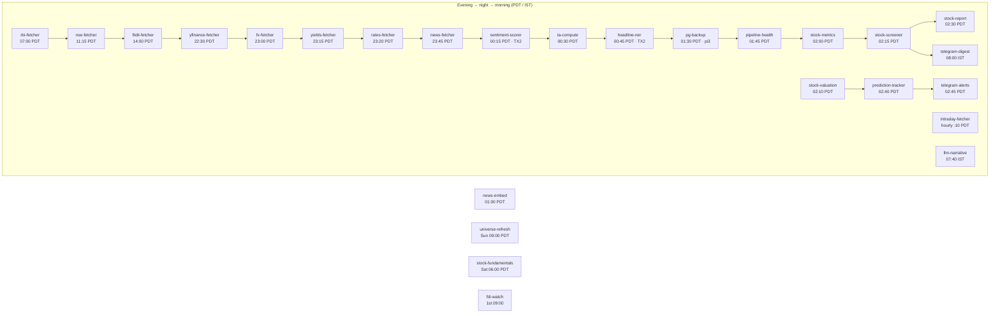
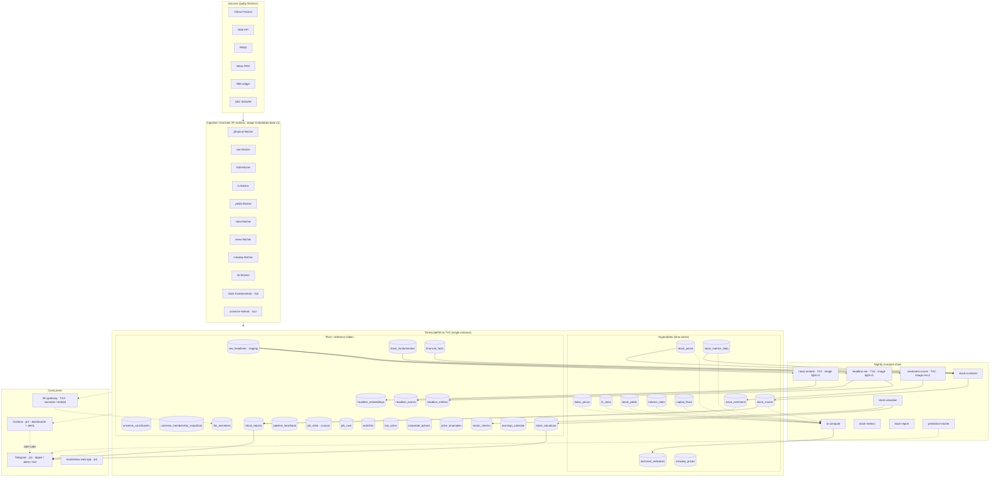

# System Architecture — how the projects work and communicate

> **Purpose:** one visual reference for the whole pipeline — every component,
> every data flow, every schedule, and who talks to whom. Mermaid fenced blocks
> render natively on GitHub and in most markdown viewers.
>
> **Source of truth:** `docs/market-data-architecture.md` (canonical), plus
> `docs/pending-tasks.md`, `docs/project-candidates.md`, and the live cluster
> state verified 2026-10-31.
>
> **Arrow convention:** solid → write/pull · dashed ◀ read/control-plane · dotted ⋯ query-or-heartbeat
> **Color key:** ⬜ source · ⬛ k8s workload · ⬛ storage · ⬜ output/consumer

---

## 1. System context — the 30-second view

```mermaid
flowchart LR
    subgraph EXT["External sources — pulled, never pushed. Keyless except FRED"]
        YF["Yahoo Finance<br/>indices · FX · futures · stocks"]
        NSE["NSE API<br/>indices · FII/DII flows"]
        FRED["FRED API<br/>DFF · DGS2/10/30 · key in Secret"]
        RSS["News RSS<br/>ET · BS · LiveMint · CNBC · ..."]
        RBIW["RBI rates widget<br/>scraped (current-only)"]
        EDGR["SEC EDGAR XBRL<br/>+ Wikipedia / NSE archives"]
    end

    subgraph K8S["k3s cluster · market-data namespace · Tailscale-only perimeter"]
        direction TB
        JOBS[("35 CronJobs + 2 Deployments<br/>fetchers · scorers · screener · telegram")]
        TSDB[("TimescaleDB 2.30.1-pg16<br/>single instance · TX2 sda4 SSD")]
        GRAF["Grafana 12<br/>pi3 · 6 dashboards · 3 alert rules"]
        TGB[("Telegram<br/>digest CronJob + two-way listener<br/>pinned pi1")]
    end

    ADMIN["Admin workstation<br/>kubectl · ops-tools SSH helpers"]
    PHONE["Owner's phone<br/>Telegram client (allow-list)"]

    EXT --> JOBS
    JOBS -- "DELETE+INSERT idempotent<br/>(own key+ts rows, ADR 0005)" --> TSDB
    TSDB --> GRAF
    TSDB --> TGB
    GRAF -- "alert rules: stale feed · VIX · FII" --> TGB
    TGB -- "digest 08:00 IST · command replies" --> PHONE
    PHONE -- "/status /scores /nifty …" --> TGB
    ADMIN -- "kubectl + paramiko over tailnet" --> K8S
```



---

## 2. Deployment view — where everything runs

```mermaid
flowchart TB
    ADMIN["Admin workstation<br/>(<admin-tailnet-ip> on tailnet)<br/>kubectl · ops-tools/{runcmd,putfile,getfile}.py"]

    subgraph LAN["LAN — CGNAT: zero inbound ports. Remote admin via Tailscale only"]
        direction TB

        subgraph PI0["pi0 · DNS only · not in k8s · not on tailnet"]
            DNS["Pi-hole v6.4.3 + unbound"]
        end

        subgraph PI2["pi2 · CONTROL-PLANE · 1 GB · fragile<br/>(cordoned: node.kubernetes.io/unschedulable)"]
            API["k3s-server v1.36.4+k3s1<br/>kine/sqlite — CronJob scheduling"]
        end

        subgraph PI1["pi1 · worker · 1 GB + 233 GB SSD"]
            W1["daily fetchers · ta-compute<br/>telegram listener + digest (pinned pi1)"]
        end

        subgraph PI3["pi3 · worker · 1 GB + USB SSD"]
            W3["Grafana (hostPath sqlite)<br/>pg-backup dumps · 7-day retention"]
        end

        subgraph TX2["ahytx2-desktop · TX2 · 7.7 GB RAM · tainted gpu=true"]
            W2["sentiment-scorer · headline-ner (TX2-only)"]
            TSDB[("TimescaleDB StatefulSet<br/>hostPath /mnt/tx2-ssd/pgdata<br/>PV 30 Gi · Retain · QoS Guaranteed")]
        end
    end

    ADMIN -. "SSH paramiko + kubectl via tailnet" .-> API
    W1 -->|k3s agent (direct 6443)| API
    W3 -->|k3s agent (direct 6443)| API
    W2 -->|k3s agent (pinned v1.35.3+k3s1)| API
```

**Node responsibilities (live, 2026-10-31):**

| Node | Role | Runs |
|------|------|------|
| pi2 | Control-plane (cordoned) | k3s API server, scheduler, etcd-kine |
| pi1 | Worker — ingestion pool | `stock-prices`, `nse-fetcher`, `fiidii-fetcher`, `yfinance-fetcher`, `fx-fetcher`, `yields-fetcher`, `rates-fetcher`, `news-fetcher`, `intraday-fetcher`, `stock-metrics`, `stock-screener`, `stock-report`, `stock-valuation`, `stock-fundamentals`, `accuracy-check`, `earnings-calendar`, `prediction-tracker`, `membership-history`, `research-watcher`, `universe-refresh`, `pipeline-health`, `pg-backup` no (pi3) |
| pi3 | Worker — Grafana + backup | Grafana, `pg-backup` |
| TX2 | GPU/tainted + DB host | TimescaleDB, `sentiment-scorer`, `headline-ner`, `llm-gateway` (own namespace) |
| pi0 | DNS only (outside k8s) | Pi-hole + unbound |
| Admin | Management | kubectl, ops-tools, builds |

---

## 3. Temporal view — the CronJob chain (when each fires)

Schedules are **node-local PDT** (ADR 0002); `telegram-digest` and `llm-narrative` use explicit `Asia/Kolkata` timeZone.



Class definitions (for visual grouping):
- `:::embed` — ML-2 embedding pipeline
- `:::weekly` — weekly legs (Sun/Sat)
- `:::monthly` — FDI watch (1st of month)

**Dependencies between jobs (what feeds what):**

| Producer job | Writes | Consumer job(s) | Reads |
|--------------|--------|-----------------|-------|
| `news-fetcher` (23:45) | `raw_headlines` | `sentiment-scorer` (00:15), `headline-ner` (00:45), `news-embed` (01:00) | headlines |
| `sentiment-scorer` | `news_sentiment` | `telegram-digest`, `stock-report` | sentiment |
| `headline-ner` | `headline_entities`, `headline_events` | `telegram-digest` (entity context) | entities |
| `stock-prices` (23:30) | `stock_prices` | `stock-metrics`, `stock-screener`, `pipeline-health` | prices |
| `stock-fundamentals` (Sat 06:00) | `stock_fundamentals`, `financial_facts` | `stock-screener` (FUND_SOURCE switch) | fundamentals |
| `stock-metrics` (02:00) | `stock_metrics_daily` | `stock-screener` | metrics |
| `stock-screener` (02:15) | `stock_scores` | `stock-report`, `telegram-digest` | scores |
| `stock-report` (02:30) | `stock_reports` | `telegram-digest` | report markdown |
| `stock-valuation` (02:10) | `stock_valuations`, `sector_metrics` | `telegram-digest` (fair-value panel) | valuations |
| `prediction-tracker` (02:40) | `prediction_snapshots` | `telegram-digest` (watch alert) | predictions |
| `universe-refresh` (Sun 09:00) | `universe_constituents` | all screener jobs | universe |
| `pipeline-health` (01:45) | `pipeline_heartbeat` | Grafana alerts | freshness |
| Grafana alerts | — | `telegram-alerts` (02:45) | alert messages |

---

## 4. Data flow — ingestion → storage → output (Mermaid)



Class definitions: `:::src` source · `:::out` output/consumer.

---

## 5. Database schema — entity relationships (logical, no physical FKs)

```mermaid
erDiagram
    TICKER_NAMES ||--o{ INDEX_PRICES : "ticker → display name"
    TICKER_NAMES ||--o{ INTRADAY_PRICES : "ticker → display name"
    INDEX_PRICES ||--o{ TECHNICAL_INDICATORS : "ticker+ts → RSI/MACD/MA"
    RAW_HEADLINES ||--o{ NEWS_SENTIMENT : "staged → FinBERT-scored"
    RAW_HEADLINES ||--o{ HEADLINE_ENTITIES : "gazetteer instrument links"
    RAW_HEADLINES ||--o{ HEADLINE_EVENTS : "16-type keyword taxonomy"
    RAW_HEADLINES ||--o{ HEADLINE_EMBEDDINGS : "ml-2 vector"
    UNIVERSE_CONSTITUENTS ||--o{ STOCK_PRICES : "symbol"
    UNIVERSE_CONSTITUENTS ||--o{ STOCK_FUNDAMENTALS : "symbol"
    UNIVERSE_CONSTITUENTS ||--o{ STOCK_METRICS_DAILY : "symbol"
    UNIVERSE_CONSTITUENTS ||--o{ STOCK_SCORES : "symbol"
    STOCK_PRICES ||--o{ STOCK_METRICS_DAILY : "price-derived"
    STOCK_FUNDAMENTALS ||--o{ STOCK_SCORES : "factor input"
    STOCK_METRICS_DAILY ||--o{ STOCK_SCORES : "factor input"
    STOCK_SCORES ||--o{ STOCK_REPORTS : "shortlist → markdown"
    STOCK_SCORES ||--o{ STOCK_VALUATIONS : "score → fair value"
    SECTOR_METRICS ||--o{ STOCK_VALUATIONS : "sector → method relevance"

    TICKER_NAMES { string ticker PK; string name }
    INDEX_PRICES { string ticker PK; timestamptz ts PK; float close }
    STOCK_PRICES { string symbol PK; timestamptz ts PK; float adj_close }
    STOCK_FUNDAMENTALS { string symbol PK; timestamptz ts PK; string metric PK; string source PK; float value }
    FINANCIAL_FACTS { string symbol PK; string source PK; string metric PK; date period_end PK; int duration_days PK; timestamptz filed PK; float value }
    STOCK_METRICS_DAILY { string symbol PK; timestamptz ts PK; string metric PK; float value }
    STOCK_SCORES { string symbol PK; timestamptz ts PK; string universe; float composite; int rank; bool eligible }
    STOCK_REPORTS { string symbol PK; timestamptz ts PK; string report_md }
    STOCK_VALUATIONS { string symbol PK; timestamptz ts PK; float fair_value; float upside_pct }
    SECTOR_METRICS { string sector PK; timestamptz ts PK; float median_pe; int method_count }
    NEWS_SENTIMENT { string headline PK; timestamptz ts PK; float sentiment_score }
    HEADLINE_EMBEDDINGS { bigint headline_id PK; float4[] embedding }
    PIPELINE_HEARTBEAT { string feed PK; bool fresh; timestamptz last_data_ts }
    JOB_STATE { string job_name PK; string cursor }
    WATCHLIST { string chat_id PK; string symbol PK }
    BOT_USERS { string chat_id PK; string name }
```

*No physical foreign keys by design — every fetcher owns its `(key, ts)` rows and upserts idempotently (ADR 0005). Referential shape lives in the query layer (JOINs on ticker/symbol).*

---

## 6. Image / build view — no registry by design (ADR 0004)

```mermaid
flowchart LR
    subgraph DEV["Admin workstation"]
        CODE[edit code + Dockerfile]
        TAG[bump tag in cronjob.yaml]
    end

    subgraph TX2["TX2 — native ARM64 build"]
        BUILD[docker build -t local/name:vN]
        SAVE[docker save | gzip → tarball]
        SUMS[sha256sum → SHA256SUMS.all]
        STORE["/mnt/tx2-ssd/image-tarballs/"]
    end

    subgraph NODES["pi1 · pi2 · pi3 — k3s containerd"]
        IMPORT[k3s ctr -n k8s.io images import]
        VERIFY[ctr images ls — confirm tag present]
    end

    subgraph CLUSTER["k3s API (pi2)"]
        APPLY[kubectl apply -f cronjob.yaml]
        CANARY[kubectl create job --from=cronjob/name]
        CHECK[check OK-marker + DB rows]
    end

    DEV --> TX2
    TX2 --> NODES
    NODES --> CLUSTER
    STORE -. "restore source if containerd store is lost<br/>(incident 2026-10-18 — never prune-all)" .- TX2
```

**Live images on TX2 (2026-10-31, after pruning):**

| Image | Node(s) | Used by |
|-------|---------|---------|
| `local/marketdata-light:v1` | TX2 + pi1/pi3 | headline-ner, sentiment-scorer (TX2 only via taint), rbi-fetcher, factors-fetcher, news-fetcher, etc. |
| `local/marketdata-data:v1` | pi1/pi3 (+ tarball on TX2) | all unpinned CronJobs (stock-prices, nse-fetcher, yfinance-fetcher, screener chain, fundamentals, metrics, report, valuation, ...) |
| `local/marketdata-ml:v1` | TX2 | sentiment-scorer (GPU taint path) |
| `local/litellm-database:1.106.0` | TX2 | llm-gateway Deployment |
| `local/marketview:v12` | pi1 | marketview web app |
| `local/telegram-digest:v34` | pi1 | telegram-bot, telegram-digest, telegram-alerts |
| `timescale/timescaledb:2.30.1-pg16` | TX2 | TimescaleDB StatefulSet |
| `grafana/grafana:12.2.0` | pi3 | Grafana |

All images: `imagePullPolicy: Never` → a missing tarball is immediately visible, never a slow mysterious pull.

---

## 7. Component interaction matrix — who talks to whom

| From → To | TimescaleDB | Grafana | Telegram | LLM gateway | External feed | k8s API |
|-----------|-------------|---------|----------|-------------|---------------|---------|
| **Fetchers** (35 CronJobs) | WRITE (DELETE+INSERT own rows) | — | — | — | READ (pull) | schedule only |
| **ta-compute** | READ prices → WRITE indicators | — | — | — | — | — |
| **sentiment-scorer** | READ headlines → WRITE sentiment | — | — | — | — | TX2-only |
| **headline-ner** | READ headlines → WRITE entities/events | — | — | — | — | TX2-only |
| **news-embed** | READ headlines → WRITE embeddings | — | — | CALL (embed) | — | TX2-only |
| **stock-screener** | READ prices/fundamentals → WRITE scores | — | — | — | — | — |
| **stock-valuation** | READ prices/fundamentals → WRITE valuations | — | — | — | — | — |
| **stock-report** | READ scores → WRITE reports | — | READ (digest content) | — | — | — |
| **prediction-tracker** | READ scores → WRITE snapshots | — | — | — | — | — |
| **pipeline-health** | READ all feeds → WRITE heartbeat | — | — | — | — | — |
| **pg-backup** | READ (pg_dump) | — | — | — | — | writes to pi3 SSD |
| **Grafana** | READ (grafana_ro, SELECT only) | — | — | — | — | — |
| **Grafana alerts** | READ heartbeat/freshness | — | WRITE (alert messages via contact point) | — | — | — |
| **Telegram listener** | READ (telegram_app: watchlist/bot_users) | — | — | — | — | getUpdates long-poll |
| **Telegram digest** | READ (telegram_app) | — | WRITE (sendMessage) | — | — | 08:00 IST |
| **marketview** | READ (grafana_ro or dedicated) | — | — | — | — | served on pi1 tailnet |
| **llm-gateway** | — | — | — | — | — | own namespace `llm` |
| **llm-narrative** | READ facts | — | — | CALL (fast-json/general) | — | 07:40 IST |
| **Admin** | READ-ONLY via psql | — | — | — | — | WRITE (kubectl apply) |

**Security boundaries (AR-8 roles):**
- `postgres` — pipeline jobs + schema Job (full DDL/DML on public tables)
- `grafana_ro` — SELECT on all tables + future via default privileges; `default_transaction_read_only=on`
- `telegram_app` — SELECT all + INSERT/UPDATE/DELETE on `watchlist`/`bot_users` only

---

## 8. How a change propagates — the §6 rebuild cycle

When any fetcher code changes:

```
edit code on admin
    ↓
bump tag in cronjob.yaml (e.g. screener:v28 → v29)
    ↓
build natively on TX2: docker build -t local/screener:v29
    ↓
verify in-image contents vs repo HEAD (md5 per COPY'd file)  ← step 3b, added after v33 burn
    ↓
docker save | gzip → /mnt/tx2-ssd/image-tarballs/screener-v29.tar.gz
    ↓
sha256sum regenerate SHA256SUMS.all (never prune-all — removes every Never-pull image)
    ↓
putfile tarball to target node(s) (TX2-only images skip distribution)
    ↓
k3s ctr -n k8s.io images import on each target node (pi2: detached nohup + poll)
    ↓
kubectl apply -f cronjob.yaml   (live spec now references v29)
    ↓
kubectl create job --from=cronjob/screener   (canary)
    ↓
check OK-marker in job logs + DB row counts
    ↓
record tag in ops manual + pending-tasks; tarball archive stays as restore source
```

---

## 9. Failure detection & escalation chain

```mermaid
sequenceDiagram
    autonumber
    participant HB as pipeline-health (01:45 PDT)
    participant PH as pipeline_heartbeat (14 feeds)
    participant GR as Grafana alert rules (10-min eval)
    participant TP as Telegram contact point
    participant PHN as owner's phone (allow-listed chat)
    participant ADMIN as admin workstation

    HB->>PH: upsert freshness per feed (max(ts), row count, fresh flag)
    PH->>GR: rules query freshness, VIX level, FII flows
    alt rule fires
        GR->>TP: stale feed / VIX > 30 / FII < -5000 / sentiment < -0.15
        TP->>PHN: alert message
    else no rule
        GR-->>GR: silent
    end
    ADMIN->>PH: manual check via psql / kubectl (read-only by default)
    Note over HB,PHN: thresholds retuned 2026-10-12 (VIX 30, FII -5000);<br/>FII/sentiment re-tune due ~2026-12 with 60 days of history
```

---

## 10. Project-to-project dependency map (from pending-tasks + project-candidates)

```mermaid
graph TD
    subgraph CORE["Core pipeline (live)"]
        INGEST[Ingestion fetchers]
        SCR[Stock screener]
        TGB[Telegram bot/digest/alerts]
        GRAF[Grafana]
        DB[(TimescaleDB)]
    end

    subgraph EV["EV domain — evidence-gated signals"]
        EV0[EV-0 signal test harness]
        EV1[EV-1 historical membership]
        EV2[EV-2 statement history]
        EV9[EV-9 more statement lines]
        EV10[EV-10…14 profitability/investment/accruals]
        EV17[EV-17 composite v2]
        EV18[EV-18 measured confidence]
    end

    subgraph ML["ML domain (never bypasses EV §5)"]
        ML0[ML-0 experiment infra]
        ML1[ML-1 anomaly detection]
        ML2[ML-2 embeddings + stories]
        ML3[ML-3 volatility]
        ML5[ML-5 peer clusters]
        ML6[ML-6 GBM ranker]
        ML7[ML-7 LLM narrative / /ask]
    end

    subgraph PV["PV domain — prediction validation"]
        PV1[PV-1 model-health dashboard]
        PV2[PV-2 ledger extension]
        PV3[PV-3 drift monitor]
    end

    subgraph OPS["Operational fixes (found 2026-10-31)"]
        MEM[Memory pressure on 1 GB workers]
        JOB[Re-fired backfill Jobs]
        MDJ[mdjob adoption]
        BKP[Backup staleness alert]
        NW2[Second nodewatch watcher]
    end

    INGEST --> DB
    SCR --> DB
    TGB --> DB
    GRAF --> DB
    DB --> TGB

    EV0 -->|gate| EV17
    EV1 -->|unblocks US signals| EV0
    EV9 -->|fills statement lines| EV10
    EV10 -->|feeds| EV17
    EV17 -->|composite decision| EV18

    ML0 -->|harness| ML1
    ML0 -->|harness| ML3
    ML2 -->|embeddings| ML7
    EV0 -->|gate| ML6
    EV1 -->|gate| ML6
    EV17 -->|gate| ML6

    PV1 -->|ledger| PV2
    PV2 -->|drift| PV3

    MEM -->|unblocks| INGEST
    JOB -->|cleans| INGEST
```



**Execution order implied by gates:**
1. `EV-0 §5 re-run` (A1) — house-prescribed next; unblocks composite v2
2. `EV-1 US` already done; `EV-1 India` deferred (NSE PDFs)
3. `EV-10…14` → `EV-17 composite v2` → `EV-18 measured confidence` (per-universe weights = owner decision)
4. `ML-6 GBM ranker` — hard-gated on EV-0 + EV-1 + EV-17 all passing §5
5. `ML-0` → `ML-1`/`ML-3`/`ML-5` — each shares EV-0 harness, each passes §5 independently
6. `ML-2` embeddings already live; `ML-7c story summaries` next after 0.82 hand-check
7. `PV-1` → `PV-2` → `PV-3` — prediction ledger already writing; outcomes accrue from 2026-11-26

---

## 11. Quick reference: key ADRs that govern communication

| ADR | Topic | Effect on inter-project communication |
|-----|-------|--------------------------------------|
| 0004 | No registry | Images built on TX2, tarball-distributed, `Never` pull — a missing tarball is visible immediately |
| 0005 | Idempotent fetchers | DELETE+INSERT own `(key, ts)`; unique indexes enforce dedup — re-runs never duplicate |
| 0009 | Telegram layer | Digest + two-way listener + Grafana alerts all route through Telegram contact point |
| 0013 | stock_prices.ts = 00:00 UTC | All price readers/writers agree on the timestamp convention |
| 0015 | financial_facts point-in-time | Screener reads EDGAR `filed <= as_of`; stale series fall back to yfinance |
| 0018 | EV-0 measurement gate | No scoring/ML change lands without passing EV §5 |
| 0022/0023 | LLM gateway | All LLM calls via shared gateway; public data only; never a scoring input; silent degradation |
| 0026 | Valuation is descriptive | 10-method panel writes `stock_valuations`; composite untouched |
| 0029 | Universe expansion | S&P 1500 + Nifty Total Market = 2,251 names; screener/marketview cover new universes once fundamentals land |
| 0032 | DB contract | Applications read `v_*` views carrying the `ts >=` bound; open-ended per-symbol reads are banned |

---

*Diagrams are Mermaid fenced blocks — they render on GitHub, GitLab, VS Code with Mermaid preview, and most markdown viewers. To regenerate or extend, edit this file and re-verify against `docs/market-data-architecture.md` and the live cluster (`kubectl -n market-data get cronjobs`, `kubectl get nodes`, `pipeline_heartbeat` freshness).*
